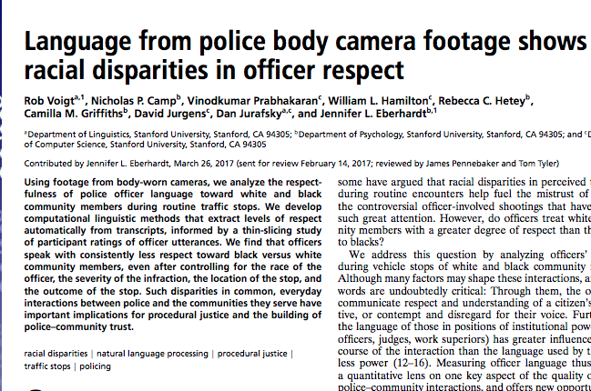

# Plans for Today

1.  Text mining: supervised analyses

2.  Unsupervised analyses

3.  LLMs for text classification


```{python}
#| include: false
import pandas as pd
import numpy as np
import re

## nltk: tokenizing, part-of-speech tagging, stopwords, stemming
import nltk
from nltk import pos_tag
from nltk.tokenize import word_tokenize, wordpunct_tokenize
from nltk.corpus import stopwords
from nltk.stem.porter import PorterStemmer

## download nltk resources (only downloads the first time)
## older nltk versions use punkt/averaged_perceptron_tagger;
## newer ones use punkt_tab/averaged_perceptron_tagger_eng
_ = nltk.download(['punkt', 'punkt_tab',
                   'averaged_perceptron_tagger',
                   'averaged_perceptron_tagger_eng',
                   'stopwords'], quiet = True)

## spacy for named entity recognition --- if you get an error,
## run this in terminal: python -m spacy download en_core_web_sm
import spacy
nlp = spacy.load('en_core_web_sm')

## sentiment analysis
from vaderSentiment.vaderSentiment import SentimentIntensityAnalyzer

## document-term matrix and topic models
from sklearn.feature_extraction.text import CountVectorizer
from gensim import corpora
import gensim
import pyLDAvis
import pyLDAvis.gensim_models as gensimvis

pd.set_option('display.max_columns', None)

## calling LLM APIs
import requests
import yaml
import time

import warnings
warnings.filterwarnings("ignore")
```

# Text mining: supervised analyses {background-color="#447099"}

## What do I mean by "supervised"?

1.  **Text mining:** look for a pre-specified concept or category. Methods:

    -   **Pattern matching:** look for a match for a specific sequence of characters
    -   **Dictionary:** a list of words we think represent a category or concept (e.g., to classify a review as negative, we might use words or phrases like *boring*, *terrible*, *awful*, *literally the worst*)

2.  **Supervised machine learning (SML) for classification** (covered in DS2): pre-specify a category at the document level and learn how text predicts that category

    -   **Inputs (training data):**
        -   *Text*: movie review; legislative bill; message board chain; admissions essay
        -   *Label for that text*: negative or not; Republican sponsor or not; contentious or not; accepted or not
    -   **Method:** often binary classification
    -   **Output:** a classifier we can apply to unlabeled data

## Example of combining text mining with supervised ML

::: columns
::: {.column width="45%"}
{width=100%}
:::

::: {.column width="55%"}
-   Human raters coded snippets of transcripts to generate labels of whether the interaction was "respectful" or not in a smaller sample of documents
-   Generated features from the text using dictionary-based methods, e.g.:
    -   **Informal titles:** "dude\*", "bro\*", "boss", "bud", "buddy", "champ", "man", "guy\*", "brotha", "sista", "son", "sonny", "chief"
    -   **Time minimizing:** `(minute|min|second|sec|moment)s?|this[^.,?!]+quick|right back`
-   Built a model to predict respect ratings using those features
:::
:::

## Our working example: NYC Airbnb listings

```{python}
## path relative to the slides folder
ab = pd.read_csv("../datasets/airbnb_text.zip")
ab.head()
```

**Key variables:** `name`: descriptive listing; `name_upper`: uppercase version; `neighbourhood_group`: borough; `price`: price of listing

## What text features might be correlated with price?

<span style="color:#9932CC;">**Positive words/euphemisms:**</span> nice; cozy; privat/private/pvt; comfy

<span style="color:#007A85;">**Proximity to landmarks:**</span> Little Italy; Chinatown; NYU; SOHO; Times Sq

<span style="color:#E6007E;">**Proximity to airports:**</span> JFK; LGA

| name | borough | price |
|------------------------------------------|-------------|------:|
| <span style="color:#9932CC;">Nice</span> and <span style="color:#9932CC;">cozy</span> little apt available | Bronx | 75 |
| <span style="color:#9932CC;">Cozy</span> and <span style="color:#9932CC;">privat</span> studio near <span style="color:#007A85;">Times Sq</span> | Manhattan | 140 |
| NYCT02-3: Private Sunny Rm, <span style="color:#007A85;">NYU, Baruch, SOHO</span> | Manhattan | 75 |
| Prime area in <span style="color:#007A85;">Chinatown</span> and <span style="color:#007A85;">Little Italy</span> | Manhattan | 160 |
| 2BR <span style="color:#9932CC;">Comfy</span> Apt - 15min from <span style="color:#007A85;">MIDTOWN</span> | Queens | 150 |
| FourTwin bunkbeds- 5 minutes from <span style="color:#E6007E;">JFK</span> | Queens | 90 |
| Pvt Room in Quiet Home <span style="color:#E6007E;">JFK</span> 6mi <span style="color:#E6007E;">LGA</span> 10mi | Queens | 38 |

## {.centered}

### How might we go about creating indicators for whether the listing contains those attributes?

# Manual lookup of words or counting words from a dictionary {background-color="#447099"}

## Manual approach 1: looking for a single word {.smaller}

```{python}
## using the `name_upper` var, flag listings that mention cozy
## (na = False treats missing listing names as not mentioning cozy)
ab['is_cozy'] = np.where(ab.name_upper.str.contains("COZY", na = False),
                         True, False)

## find the mean price by borough and whether the listing mentions cozy
mp = pd.DataFrame(ab.groupby(['is_cozy',
                              'neighbourhood_group'])['price'].mean())

## reshape to wide format so that each borough is a row;
## one col is the mean price for listings that describe
## the place as cozy; other col is mean price for listings
## without that word
mp_wide = pd.pivot_table(mp, index = ['neighbourhood_group'],
                         columns = ['is_cozy'])
mp_wide.columns = ['no_mention_cozy', 'mention_cozy']
```

## Result: within the same borough, higher prices for listings that *don't* describe the place as cozy

```{python}
mp_wide
```

## Manual approach 2: create a dictionary of words summarizing a concept

```{python}
## construct dictionary
space_indicators = {'small': ['COZY', 'COMFY', 'LITTLE', 'SMALL'],
                    'large': ['SPACIOUS', 'LARGE', 'HUGE', 'GIANT']}
space_indicators['small']

## for each listing, we want the number of occurrences
## of words in each key --- first, test with one listing
practice_listing = "NICE AND COZY LITTLE APT AVAILABLE WITH HUGE DECK"
practice_listing.split(" ")
```

## Counting the number of appearances in one listing {.smaller}

Double counts if a word appears twice

```{python}
### split at space and look at overlap with each key in the dictionary
words_overlap_small = [word for word in practice_listing.split(" ")
                       if word in space_indicators['small']]
words_overlap_large = [word for word in practice_listing.split(" ")
                       if word in space_indicators['large']]
words_overlap_small
words_overlap_large

### could then take length as a fraction of all words
len(words_overlap_small)/len(practice_listing.split(" "))
len(words_overlap_large)/len(practice_listing.split(" "))
```

# Automated process 1: part-of-speech tagging {background-color="#447099"}

## Intro to part-of-speech (POS) tagging and named entity recognition (NER)

-   The previous approach was very manual --- we needed to read some listings and manually construct a dictionary of adjectives we thought were related to a concept

-   We also didn't capture other price-relevant attributes of the listing, or what we might call **named entities**:

    1.  **Places:** e.g., Chinatown, Little Italy, Times Square
    2.  **Infrastructure:** e.g., LGA, JFK

## Part-of-speech tagging with an example

```{python}
## specify example
example_for_tag = "This is a chill apt next to the subway in LES Chinatown"

## part-of-speech tagging using nltk
tokens = word_tokenize(example_for_tag) # generate list of tokens
tokens_pos = pos_tag(tokens)            # generate POS tags for those tokens

## returns a list of tuples: first element is the word;
## second element is the part of speech
tokens_pos
```

## What do these mean? Common parts of speech

"This is a chill apt next to the subway in LES Chinatown"

| tag | meaning | in our example |
|-----|-----------------------------------------------|-----------------|
| CC | coordinating conjunction | |
| CD | cardinal digit | |
| DT | determiner | This; the; a |
| JJ | adjective | <span class="red">apt</span>; next |
| JJR | adjective (comparative; e.g., bigger) | |
| NN | noun (singular; e.g., desk) | <span class="red">chill</span>; subway |
| NNS | noun (plural; e.g., desks) | |
| NNP | proper noun (singular; e.g., Harrison) | LES; Chinatown |
| NNPS | proper noun (plural; e.g., Americans) | |
| TO | to | to |
| VB / VBD / VBG | verb (base / past / gerund; e.g., take, took, taking) | |
| VBZ | verb (3rd person singular present; e.g., takes) | is |

<span class="red">Red</span> = the tagger got it wrong

## After tagging, extract words with a specific part of speech

**Example:** extract the proper nouns (LES and Chinatown)

```{python}
## check if the second element in the tuple is equal to NNP;
## if so, return the first element of the tuple (the actual word)
all_prop_noun = [one_tok[0] for one_tok in tokens_pos
                 if one_tok[1] == "NNP"]
all_prop_noun
```

```{python}
## same idea for adjectives or singular nouns
all_adj_noun = [one_tok[0] for one_tok in tokens_pos
                if one_tok[1] == "JJ" or one_tok[1] == "NN"]
all_adj_noun
```

# Automated process 2: named entity recognition {background-color="#447099"}

## Named entity recognition

-   POS tagging is useful for broad categories --- e.g., LES and Chinatown both tagged as proper nouns

-   With named entity recognition, we classify proper nouns into more granular subtypes. See [the spaCy docs](https://spacy.io/usage/linguistic-features#named-entities) for a full list; some relevant ones:

    -   `PERSON`: e.g., Professor Xavier
    -   `FAC`: buildings, highways, bridges --- e.g., Boston Logan International Airport
    -   `GPE`: countries, cities, states --- e.g., Washington, DC
    -   `DATE`: e.g., May 4th, 2021

-   To do this, we switch from the `nltk` package to the `spaCy` package

## Example tweet to find named entities in

> When AOL was founded in the year 2000 I remember raising my hand and asking 'well...if you're using my data - where is my \$50' and no one had a good answer...and there still isn't one.

<span style="color:#9932CC;">**Which words do we think will be tagged as named entities?**</span>

```{python}
## modified from a real tweet
m_tweet = """When AOL was founded in the year 2000 I remember raising my hand
and asking 'well...if you're using my data - where is my $50'
and no one had a good answer...and there still isn't one.
"""
```

## Code to get named entities from that tweet

```{python}
spacy_dtweet = nlp(m_tweet)
type(spacy_dtweet)

for one_tok in spacy_dtweet.ents:
    print("Entity: " + one_tok.text +
          "; NER tag: " + one_tok.label_)
```

**Breaking this down:**

-   `nlp`: black-boxy function within spaCy that adds tags to a string (not only named entities)
-   `spacy_dtweet.ents`: extracting all named entities from the spaCy object
-   `one_tok`: arbitrary placeholder for one entity
-   `one_tok.text`: original string
-   `one_tok.label_`: named entity label for that string

## Generalizing to a column of strings {.smaller}

```{python}
## for runtime purposes, just taking a few airbnb listings
ab_name_examples = ab.name[10:15]
ab_name_examples

## define function that takes in one airbnb string
def get_gpe(one_string):
    tagged_str = nlp(one_string) # tag

    ## (1) iterate over entities, (2) check if the label
    ## is GPE (place), and (3) if so, return the original entity
    all_gpe = [one_tok.text for one_tok in tagged_str.ents
               if one_tok.label_ == "GPE"]
    return all_gpe

## apply over the examples
[get_gpe(one_string) for one_string in ab_name_examples]
```

## In-class activity {background-color="#449998"}

See Activity 1 in notebook

## One variation: lowercase "aol"

```{python}
m_tweet_lower = m_tweet.replace("AOL", "aol")

for one_tok in nlp(m_tweet_lower).ents:
    print("Entity: " + one_tok.text + "; NER tag: " + one_tok.label_)
```

# Automated process 3: sentiment analysis {background-color="#447099"}

## Sentiment analysis: dictionary-based approach

-   Operates similarly to our manual dictionary but, in this case, keys are words in a "lexicon" and values are the sentiment score

-   In basic form, a dictionary of two types of words (often non-exhaustive; other words treated as neutral):

    1.  Positive
    2.  Negative

-   We'll use the **VADER** (Valence Aware Dictionary and sEntiment Reasoner) lexicon

## VADER sentiment scoring: calculating sentiment

```{python}
## initialize a scorer
sent_obj = SentimentIntensityAnalyzer()

## score one listing
practice_listing = "NICE AND COZY LITTLE APT AVAILABLE"
sentiment_example = sent_obj.polarity_scores(practice_listing)
sentiment_example
```

**Breaking this down:**

-   `sent_obj = SentimentIntensityAnalyzer()`: initializing a scorer
-   `sent_obj.polarity_scores(practice_listing)`: apply the polarity scores function to the string we feed it
    -   Score is aggregated to the level of the text you feed it; here we're scoring a sentence, but you might score a paragraph or document

**Output:** dictionary with four keys --- `neg`, `neu`, `pos`, and `compound` (summary of pos, neg, and neutral; standardized between -1 = most negative and +1 = most positive)

## Scoring a few more examples

```{python}
## adding phrase with word terrible
practice_listing_2 = "NICE AND COZY LITTLE APT AVAILABLE. REALLY TERRIBLE VIEW."
sentiment_example_2 = sent_obj.polarity_scores(practice_listing_2)

## adding phrase about rats; bad but might not be in scoring dictionary
practice_listing_3 = "NICE AND COZY LITTLE APT AVAILABLE. HAS RATS THOUGH."
sentiment_example_3 = sent_obj.polarity_scores(practice_listing_3)

## summarize all 3
print("String: " + practice_listing + " scored as:\n" + str(sentiment_example))
print("String: " + practice_listing_2 + " scored as:\n" + str(sentiment_example_2))
print("String: " + practice_listing_3 + " scored as:\n" + str(sentiment_example_3))
```

**Issues:**

-   Many words classified as neutral
-   Appropriately scored *terrible* as negative, but didn't know that, in this context, *rats* should be scored negatively

## One way to improve: augment the default VADER dictionary {.smaller}

```{python}
## the lexicon is a dictionary: key is the word; value is the score
## here, benchmarking the negativity of rodents to the word aversion
sent_obj.lexicon['aversion']

## create a dictionary with negative scores for pests
pest_words = {'rat': -1.9, 'rats': -1.9,
              'mice': -1.9, 'mouse': -1.9,
              'roach': -1.9, 'cockroach': -1.9}

## update the lexicon with that dictionary (creating a new
## sentiment object to avoid writing over the older one)
new_si = SentimentIntensityAnalyzer()
new_si.lexicon.update(pest_words)

## re-score the third example
print("After lexicon update: " + practice_listing_3 + " scored as:\n" +
      str(new_si.polarity_scores(practice_listing_3)))
```

## Better way to improve (after learning ML in DS2): build a custom classifier

|            |           | **terms in listing** |     |          |       |        |     |
|------------|-----------|------|-----|----------|-------|--------|-----|
| listing_id | avg_stars | cozy | rat | spacious | cable | marble | ... |
| 1          | 2.4       | 1    | 1   | 0        | 0     | 0      |     |
| 2          | 3.8       | 0    | 0   | 1        | 0     | 1      |     |
| 3          | 4.9       | 1    | 0   | 1        | 1     | 0      |     |
| ...        |           |      |     |          |       |        |     |

# Unsupervised analyses {background-color="#447099"}

## Text mining of Airbnb listings versus topic modeling

-   Suppose we're interested in the relationship between (1) the words people use to describe their Airbnb listing and (2) neighborhood change (e.g., rapid demographic change in the ethnicity/income of residents)

-   **Text mining approach:** build a dictionary of words or phrases we think signal gentrification (*cute*; *safe*; *near cold brew*) and look at the correlation with neighborhood change

-   **Drawbacks:**

    -   Might be difficult to know in advance which words to include
    -   Lack of surprise: what if there's a pattern in the listings correlated with demographic change that we didn't anticipate?

-   Therefore, rather than search for specific words or phrases, begin with the **full text** of the document

## Tokenize/represent each document as a bag of words

-   Represent each document as a "bag of words," where order doesn't matter

```{python}
## convert to lowercase and a list
corpus_lower = ab.name.str.lower().to_list()

## tokenize the first four listings
[wordpunct_tokenize(one_listing) for one_listing in corpus_lower[0:4]]
```

-   Notice that it contains a lot of extraneous information

## Preprocess to "boost" the signal-to-noise ratio

-   **Compound words:** combine tokens into a single term:\
    \[clean\] \[<span class="red">quiet apt</span>\] \[home\] \[by\] \[the\] \[park\]

-   **Stopword removal:** remove words not related to what we're studying:\
    \[clean\] \[quiet apt\] \[home\] \[<span class="red">by</span>\] \[<span class="red">the</span>\] \[park\] $\implies$ \[clean\] \[quiet apt\] \[home\] \[park\]

-   **Stemming:** take the end off conjugated verbs or plural nouns, leaving the "stem":\
    \[clean\] \[quiet apt\] \[hom<span class="red">e</span>\] \[park\] $\implies$ \[clean\] \[quiet apt\] \[hom\] \[park\]

-   **Lemmatization:** similar goal to stemming but, rather than just stripping from the end, truncates with regard to context (e.g., treats *park* differently in "<span style="color:#9932CC;">park</span> a car" versus "a beautiful <span style="color:#9932CC;">park</span>")

## Step one: create a stopword list to filter out

**Why do this early?** If you want to create your own list of stopwords for your context, it's easier to do that before preprocessing that alters the words (e.g., stemming *apartment* to *apart*)

```{python}
## call a specific set of stopwords from nltk
list_stopwords = stopwords.words("english")

## augment with your own
custom_words_toadd = ['apartment', 'new york', 'nyc',
                      'bronx', 'brooklyn',
                      'manhattan', 'queens',
                      'staten island']
list_stopwords_new = list_stopwords + custom_words_toadd
list_stopwords_new[0:10]
```

## Step two: convert text to lowercase and filter out stopwords

```{python}
## use wordpunct tokenize on one listing
example_listing = corpus_lower[3]
wordpunct_tokenize(example_listing)

## filter out stopwords
nostop_listing = [word for word in wordpunct_tokenize(example_listing)
                  if word not in list_stopwords_new]
nostop_listing
```

## Step three: stem and additional preprocessing

```{python}
## initialize stemmer
porter = PorterStemmer()

## apply to one tokenized text by iterating over its tokens
example_listing_preprocess = [porter.stem(token)
                              for token in nostop_listing
                              if token.isalpha() and
                              len(token) > 2]
example_listing_preprocess
```

**Breaking it down:**

-   `if token.isalpha()`: only retain tokens that are words (strips things like the 1 in 1 bedroom); might skip depending on context
-   `len(token) > 2`: only retain tokens with 3+ characters; e.g., removes *br*
-   `porter.stem(token)`: use the Porter stemmer we initialized to stem the words; e.g., <span style="color:#9932CC;">entire</span> $\implies$ <span style="color:#9932CC;">entir</span>; <span style="color:#9932CC;">cozy</span> $\implies$ <span style="color:#9932CC;">cozi</span>

## In-class activity {background-color="#449998"}

See Activity 2 in notebook

## Repeat over all documents and combine into a document-term matrix

-   **More manual way:** find the union of all words by (1) creating an empty dictionary; (2) looping over the documents; (3) when a document contains a new term, add it to the dictionary as a key; (4) when a document contains a term already in the dictionary, count how many times the term appears in the doc

-   **More automatic way:** use the `sklearn` function `CountVectorizer`

## Code for more automatic document-term matrix creation {.smaller}

```{python}
def create_dtm(list_of_strings, metadata):
    ## init tokenizer and apply to list of documents
    vectorizer = CountVectorizer(lowercase = True)
    dtm_sparse = vectorizer.fit_transform(list_of_strings)

    ## convert to (1) dense matrix; (2) dataframe and (3) add metadata
    dtm_dense_named = pd.DataFrame(dtm_sparse.todense(),
                                   columns = vectorizer.get_feature_names_out())
    metadata = metadata.copy()
    metadata.columns = ["metadata_" + col for col in metadata.columns]
    dtm_dense_named_withid = pd.concat([metadata.reset_index(),
                                        dtm_dense_named], axis = 1)
    return dtm_dense_named_withid
```

**Breaking things down:**

-   `CountVectorizer`: initializes an `sklearn` tokenizer to tokenize the (preprocessed) strings
-   `vectorizer.fit_transform`: fed a list of documents; returns a sparse matrix where each row is a document, each column is a term, and values count how many times term $t$ appears in doc $d$ (sparse representation saves memory given the prevalence of zeroes)
-   `dtm_sparse.todense()`: switches from the sparse representation to the normal dense one so we can treat it as a `pandas` DataFrame
-   Remainder of the code adds back document-level covariates (what I'm calling metadata)

## Select a sample of listings to work with

```{python}
## filter out NAs; for shorter runtime, random sample of 1000;
## rename price since it's likely to be a corpus word
ab_small = (ab.loc[~ab.name.isnull(),
                   ['id', 'neighbourhood_group', 'price', 'name']]
            .copy()
            .rename(columns = {'price': 'price_rawdata'})
            .sample(n = 1000, random_state = 9899))

ab_small['name_lower'] = ab_small['name'].str.lower()
ab_small.head()
```

## Create the document-term matrix from the raw (lowercase) text

```{python}
metadata_list = ['id', 'neighbourhood_group', 'price_rawdata']
dtm_nopre = create_dtm(list_of_strings = ab_small.name_lower,
                       metadata = ab_small[metadata_list])

dtm_nopre.shape
dtm_nopre.iloc[0:5, 0:12]
```

## Use column sums to find the top words

```{python}
## sum each term column
top_terms = dtm_nopre[[col for col in dtm_nopre.columns
                       if "metadata" not in col and
                       col != "index"]].sum(axis = 0)

## sort from most frequent to least frequent
top_terms.sort_values(ascending = False).head(15)
```

What would change if we used the preprocessed text?

## In-class activity {background-color="#449998"}

See Activity 3 in notebook

# Topic models: concepts {background-color="#447099"}

## Latent Dirichlet Allocation (LDA)

-   **Idea:** documents exhibit each topic in some proportion. This is an **admixture**.

-   Each document is a mixture over topics. Each topic is a mixture over words.

-   LDA estimates:

    -   The **distribution over words** for each topic
    -   The **proportion of a document in each topic**, for each document

-   **Maintained assumptions:** bag of words; fix the number of topics ex ante

::: {style="text-align: right; font-size: 60%;"}
This and next two slides adapted from: Brandon Stewart, LDA
:::

## What this means in pictures {.smaller}

::: columns
::: {.column width="18%"}
**Say you have a lot of people**

{width=60%}

{width=60%}

{width=60%}
:::

::: {.column width="22%"}
**Each writes some texts**

{width=55%}

{width=40%}

{width=40%}
:::

::: {.column width="30%"}
**That discuss a few different topics**

<span style="color:#1E90FF;">**T1: Politics**</span> (<span style="color:#1E90FF;">0.7</span> of first doc)

> congress, nations, power, votes, agreement, bargaining

<span style="color:#D50032;">**T2: Statistics**</span> (<span style="color:#D50032;">0.3</span> of first doc)

> estimator, data, analysis, variance, model, inference
:::

::: {.column width="30%"}
**LDA estimates:**

1.  The topics --- each is a distribution over words
2.  The proportion of each document in each topic
:::
:::

## Why does this work? Co-occurrence

Where's the information for each word's topic? Reconsider the document-term matrix:

|                    | Word$_1$ | Word$_2$ | $\cdots$ | Word$_J$ |
|--------------------|:--------:|:--------:|:--------:|:--------:|
| Doc$_1$            | 0        | 1        | $\cdots$ | 0        |
| Doc$_2$            | 2        | 0        | $\cdots$ | 3        |
| $\vdots$           | $\vdots$ | $\vdots$ | $\ddots$ | $\vdots$ |
| Doc$_N$            | 0        | 1        | $\cdots$ | 1        |

-   We are learning the pattern of **which words occur together**

-   The model wants a topic to contain as few words as possible, but a document to contain as few topics as possible. This **tension** is what makes the model work.

# Topic models: implementation in Python {background-color="#447099"}

## Two routes to topic modeling

1.  Create the document-term matrix yourself; it's then compatible with a variety of clustering methods

2.  Use built-in functions in `gensim` to start with a list of preprocessed documents and end with an estimated topic model that returns:

    -   Topics and their high-probability words
    -   For each document, a $k$-length vector of topic probabilities, where $k$ is the number of topics

## Steps for topic modeling using `gensim`: in words

-   **Create a dictionary:** the union of all (preprocessed) words in the corpus (collection of documents); it's fed <span style="color:#9932CC;">tokenized text</span> and results in a dictionary where keys are a "term id" and values are the word itself

-   **Filter out words that appear in a very low proportion of documents (lower bound) or a very high proportion of documents (upper bound):** stopword removal should take care of most of the latter; the former matters since words need to co-occur in multiple documents for themes to be meaningful

-   **Apply the dictionary to the tokenized text** to create a crosswalk between (1) each word in the text and (2) that word in the filtered dictionary: drops words that were filtered out of the corpus dictionary

-   **Estimate the topic model:** use the LDA model within `gensim`

## Steps for topic modeling using `gensim`: preprocessing {.smaller}

```{python}
## Step 1: tokenize documents and store in list
## (here using raw text; in the activity you'll use the preprocessed texts)
text_raw_tokens = [wordpunct_tokenize(one_text)
                   for one_text in ab_small.name_lower]

## Step 2: use gensim to create dictionary - gets all unique words across documents
text_raw_dict = corpora.Dictionary(text_raw_tokens)

## Step 3: filter out very rare and very common words from dictionary
## no_below: integer count of docs a word must appear in (here, 5% of docs)
## no_above: max *fraction* of docs a word can appear in (here, 95%)
lower_bound = round(ab_small.shape[0]*0.05)
text_raw_dict.filter_extremes(no_below = lower_bound,
                              no_above = 0.95)

## Step 4: map words in each tokenized document to the dictionary
## output: list with one element per document; each element
## is a list of (term id, count) tuples
corpus_fromdict = [text_raw_dict.doc2bow(one_text)
                   for one_text in text_raw_tokens]
corpus_fromdict[0:3]
```

## Steps for topic modeling using `gensim`: estimation

**See the [documentation](https://radimrehurek.com/gensim/models/ldamodel.html) for many parameters you can vary!**

```{python}
## Step 5: estimate a model by feeding it: (1) the corpus
## mapped to the dictionary, (2) the number of topics (often k
## in notation), (3) the dictionary itself, and other arguments
ldamod = gensim.models.ldamodel.LdaModel(corpus_fromdict,
                                         num_topics = 4,
                                         id2word = text_raw_dict,
                                         passes = 6, alpha = 'auto',
                                         per_word_topics = True,
                                         random_state = 91988)
type(ldamod)
```

Returns a trained `LdaModel` object with various methods/attributes

## Interacting with the model output: top words for each topic

```{python}
## corpus-wide summary of topics and their top words
topics = ldamod.print_topics(num_words = 10)
for topic in topics:
    print(topic)
```

-   By default, these are the highest-probability words, which may just reflect frequently-occurring words in the corpus (note *in*, *the*, *of* --- we haven't preprocessed yet!)
-   `pyLDAvis` has ways to introduce penalties to find words more "unique to" a topic

## Interacting with the model output: topic probabilities for each document

```{python}
## for each document, get list of (topic, probability) tuples
doc_topics = [ldamod.get_document_topics(item) for item in corpus_fromdict]

## print first few documents and their topic probabilities
for tokens, probs in zip(text_raw_tokens[0:4], doc_topics[0:4]):
    print(" ".join(tokens))
    print([(topic, round(float(prob), 2)) for topic, prob in probs])
```

## Visualizing topics with `pyLDAvis`

```{python}
#| output: false
lda_display = gensimvis.prepare(ldamod, corpus_fromdict, text_raw_dict)

## save as a standalone html page and embed below
## (in a notebook, can use pyLDAvis.display(lda_display) instead)
pyLDAvis.save_html(lda_display, "week12_figs/ldavis_raw.html")
```

<iframe src="week12_figs/ldavis_raw.html" width="1500" height="750" style="border:none; background:white;"></iframe>

## Which topics are associated with higher listing prices? {.smaller}

```{python}
## long dataframe: one row per document x topic
## (minimum_probability = 0 so every doc gets all k topics)
n_topics = ldamod.num_topics
topic_probs_long = pd.DataFrame(
    [(doc_id, topic, prob)
     for doc_id, one_doc in zip(ab_small.id, corpus_fromdict)
     for topic, prob in ldamod.get_document_topics(one_doc,
                                                   minimum_probability = 0)],
    columns = ['doc_id', 'topic', 'probability'])

## pivot to wide format: one row per document, one col per topic
topic_probs_wide = topic_probs_long.pivot(index = 'doc_id', columns = 'topic',
                                          values = 'probability')
topic_probs_wide.columns = ["topic_" + str(i) for i in topic_probs_wide.columns]
topic_probs_wide = topic_probs_wide.reset_index()

## merge with original data and find each listing's top topic
topic_wmeta = pd.merge(topic_probs_wide, ab_small,
                       left_on = 'doc_id', right_on = 'id')
topic_wmeta['toptopic'] = topic_wmeta[[col for col in topic_wmeta.columns
                                       if "topic_" in col]].idxmax(axis = 1)
topic_wmeta[['name', 'topic_0', 'topic_1', 'topic_2', 'topic_3', 'toptopic']].head()
```

## Mean price by top topic

```{python}
## group by topic and find mean price
topic_wmeta.groupby('toptopic').agg({'price_rawdata': 'mean'})
```

## Mean price by top topic

```{python}
## group by topic and borough -- higher prices for some topics
## also reflect different borough composition
(topic_wmeta.groupby(['toptopic', 'neighbourhood_group'])
            .agg({'price_rawdata': 'mean'})
            .unstack())
```

## Post-modeling diagnostics: how model fit varies with the number of topics

-   **Concept:** tradeoff between two metrics:

    1.  **Within-topic coherence:** increases when the "top words" for a topic (highest-probability words) tend to co-occur in the same document; tends to be <span style="color:#9932CC;">higher if you have a few topics dominated by frequently-occurring words</span>
    2.  **Between-topic exclusivity:** increases when words are "exclusive" to a topic, or only have a high probability of appearing in a few topics; tends to be <span style="color:#9932CC;">higher as you increase the number of topics</span>, since each is more granular

-   `gensim` has a `CoherenceModel` class for calculating coherence: [documentation](https://radimrehurek.com/gensim/models/coherencemodel.html)

## Many different types of topic models

-   **Structural topic model:** allows (1) topic prevalence and (2) topic content to vary as a function of document-level covariates (e.g., do documents produced in 1990 talk about something differently than documents produced in 2020?); implemented in `stm` in R (Roberts, Stewart, Tingley, Benoit)

-   **Correlated topic model:** a way to explore between-topic relationships (Blei and Lafferty); implemented in `topicmodels` in R

-   **Keyword-assisted topic model:** seed the topic model with keywords to increase the face validity of topics for what you're trying to measure; implemented in `keyATM` in R (Eshima, Imai, Sasaki)

-   And more...

## Extensions to material we're not covering

-   **N-grams:** similar setup, but modify `create_dtm` to use bigrams (e.g., `CountVectorizer(ngram_range = (1, 2))`)

-   **Word embeddings:** bag of words treats all text in a document as an unordered collection. But the context of a word (e.g., *cozy brownstone* versus *spacious brownstone*) may matter, and we may want more flexible windows than n-grams. The basic idea behind embeddings is to (1) take a focal word (e.g., "cozy") and (2) predict its context within some window (e.g., "brownstone," "tiny," "cramped"). Each word is then represented as a vector, so *spacious* might be very close to *brownstone*, less close to *studio*, etc. [Good intro here](https://github.com/ArthurSpirling/EmbeddingsPaper/blob/master/Project_FAQ/faq.md)

## In-class activity {background-color="#449998"}

See Activity 4 in notebook

# LLMs for text classification {background-color="#447099"}

## What are large language models (LLMs)?

-   **Language model:** predicts the next word given a sequence of words --- e.g., "the students opened their \_\_\_" $\implies$ *books*, *laptops*, *exams*

-   **Large** language models (ChatGPT, Claude, Gemini, LLaMA) do the same prediction task, but:

    -   Use the **transformer** architecture, where *attention* lets the meaning of a word depend on its context (*cozy* brownstone vs. *cozy* = tiny)
    -   Have billions to trillions of parameters, trained on massive amounts of text (web, books, code)
    -   Are then fine-tuned to follow human instructions

-   **Two ways to use them:**

    -   **Out of the box with prompts:** a natural-language instruction; the model generates the next tokens conditional on the prompt (no parameter updates)
    -   **Fine-tuning:** further train the model's parameters on your own labeled data

-   **Why it matters for text as data:** tasks that used to require dictionaries (VADER), hand-labeled training data (supervised ML), or lots of human coding can now often be done with a well-designed prompt

## Usage

-   All these applications are hard to do at scale via the web-browser versions of LLMs (e.g., ChatGPT)

-   Instead, access the models via an **API** (like the APIs from week 9!) using R or Python to have them perform tasks

    -   [OpenAI API](https://openai.com/api/)
    -   [Anthropic Claude API](https://www.claude.com/platform/api)
    -   [Google AI](https://ai.google.dev/)

-   **Usually not free:** you pay per query (based on the number of tokens in the prompt and response). Cheap for small tasks; can get expensive for millions of predictions. Some providers (e.g., Google's Gemini API) have a free tier with rate limits, which we'll use today


## LLMs: classification

[Rathje et al., "GPT is an effective tool for multilingual psychological text analysis"](https://pmc.ncbi.nlm.nih.gov/articles/PMC11348013/)

-   Use **zero-shot prompting** (no labeled examples) to measure psychological concepts like sentiment in tweets, news headlines, and Reddit comments

-   **Example prompt:** "Is the sentiment of this text positive, neutral, or negative? Answer only with a number: 1 if positive, 2 if neutral, and 3 if negative. Here is the text: \[TEXT\]"

-   **Why it works --- back to next-word prediction:**

    -   The model compares, e.g., $P(\text{positive} \mid \text{"I love this class"})$ vs. $P(\text{negative} \mid \text{"I love this class"})$
    -   *Positive* doesn't need to be the most likely next word overall --- just more likely than the other labels

## LLMs: synthetic survey data

[Bisbee et al., "Synthetic Replacements for Human Survey Data? The Perils of Large Language Models"](https://doi.org/10.1017/pan.2024.5)

-   Can LLMs be used for public opinion research, or to generate synthetic survey responses?

-   Prompt LLMs to:

    -   Adopt **personas** defined by demographic and political characteristics
    -   Answer questions about their feelings toward social and political groups (0-100 "feeling thermometers")
    -   Using features taken from the American National Election Study (ANES)

-   Compare the synthetic responses to real ANES respondents

## Prompts

**Persona template:**

> It is \[YEAR\]. You are a \[AGE\] year-old, \[MARST\], \[RACETH\] \[GENDER\] with \[EDUCATION\] making \[INCOME\] per year, living in the United States. You are \[IDEO\], \[REGIS\] \[PID\] who \[INTEREST\] pays attention to what's going on in government and politics.

-   Each bracket is filled in with an ANES respondent's actual characteristics
-   The model then answers the feeling thermometer questions *as that person*

## Getting a free Gemini API key

We'll use Google's **Gemini API**, which has a free tier (no credit card needed):

1.  Go to [Google AI Studio](https://aistudio.google.com/apikey) and sign in with a Google account
2.  Click **Create API key**
3.  Add it to your `creds.yaml` file (same file as the week 9 API keys):

```yaml
gemini_api:
  api_key: "your-key-here"
```

**Caveats of the free tier:**

-   Rate limits on requests per minute and per day (check yours in [AI Studio](https://aistudio.google.com/rate-limit)) $\implies$ add a pause between calls
-   Google may use free-tier prompts and responses to improve its products $\implies$ fine for public Airbnb listings; **don't send sensitive or private data**

## Sentiment classification with an LLM: setup

Same steps as the APIs in week 9: (1) credentials, (2) construct a query, (3) call the API, (4) extract the content

```{python}
## load creds
with open("../creds.yaml", 'r') as stream:
    try:
        creds = yaml.safe_load(stream)
    except yaml.YAMLError as exc:
        print(exc)

gemini_key = creds['gemini_api']['api_key']

## Gemini's OpenAI-compatible endpoint: same request format as OpenAI's API,
## so the code works with other providers by changing the url, key, and model
gemini_url = "https://generativelanguage.googleapis.com/v1beta/openai/chat/completions"

## model to use --- see https://ai.google.dev/gemini-api/docs/models
## for current free-tier model names
gemini_model = "gemini-3.5-flash-lite"
```

## A function to prompt the model {.smaller}

```{python}
def ask_llm(question_text, api_key, model = gemini_model, url = gemini_url,
            max_tries = 5):
    headers = {
        "Authorization": f"Bearer {api_key}",
        "Content-Type": "application/json",
    }
    ## temperature = 0 makes the output (close to) deterministic
    data = {
        "model": model,
        "temperature": 0,
        ## gemini 3 models "think" before answering; low effort keeps
        ## simple classification tasks fast (thinking can't be turned off)
        "reasoning_effort": "low",
        "messages": [{"role": "user", "content": question_text}]
    }
    for attempt in range(max_tries):
        response = requests.post(url, json = data,
                                 headers = headers, timeout = 120)
        ## success: return the text of the response
        if response.status_code == 200:
            return response.json()['choices'][0]['message']['content'].strip()
        ## model overloaded (503) or rate limit hit (429): wait and retry,
        ## doubling the wait each time (2, 4, 8, ... seconds)
        if response.status_code in [429, 503]:
            wait = 2 ** (attempt + 1)
            print(f"API busy (error {response.status_code}); retrying in {wait} seconds")
            time.sleep(wait)
        else:
            ## other errors (e.g., bad key): stop and show the message
            raise Exception(f"API error {response.status_code}: {response.text}")
    raise Exception(f"API still unavailable after {max_tries} tries; try again later")


## test it
ask_llm("In one sentence, what is a large language model?", gemini_key)
```

## Zero-shot sentiment classification of Airbnb listings {.smaller}

```{python}
## sample a few listings to keep costs low
ab_llm = ab.loc[~ab.name.isnull(), ['id', 'name', 'neighbourhood_group', 'price']].sample(n = 10,
                                                        random_state = 5203).reset_index(drop = True)

## zero-shot prompt (adapted from Rathje et al.)
sentiment_prompt = ("Is the sentiment of this text positive, neutral, or negative? "
                    "Answer only with a number: 1 if positive, 0 if neutral and -1 if negative. "
                    "Here is the text: ")

## loop over listings and prompt the model
output = []
for one_listing in ab_llm.name:
    try:
        output.append(ask_llm(sentiment_prompt + one_listing, gemini_key))
    except Exception as e:
        output.append(np.nan)
    time.sleep(4) # stay under the free tier's requests-per-minute limit

## responses come back as strings; convert to numeric
output = pd.to_numeric(output, errors = 'coerce')

ab_llm['sentiment_llm'] = output
```

## Comparing the LLM to VADER

```{python}
## VADER compound score for the same listings, recoded to -1/0/1
## (using VADER's standard +/- 0.05 cutoffs)
ab_llm['vader_compound'] = [sent_obj.polarity_scores(one_listing)['compound']
                            for one_listing in ab_llm.name]
ab_llm['sentiment_vader'] = np.select([ab_llm.vader_compound >= 0.05,
                                       ab_llm.vader_compound <= -0.05],
                                      [1, -1], default = 0)

ab_llm[['name', 'sentiment_llm', 'vader_compound', 'sentiment_vader']]
```

-   Where do they disagree? Which seems more accurate?
-   Recall *rats*: the LLM doesn't need us to manually augment a lexicon --- but it's a black box, costs money, and results can change when the model is updated

## In-class activity {background-color="#449998"}

See Activity 5 in notebook


# See you next week! {background-color="#447099"}
