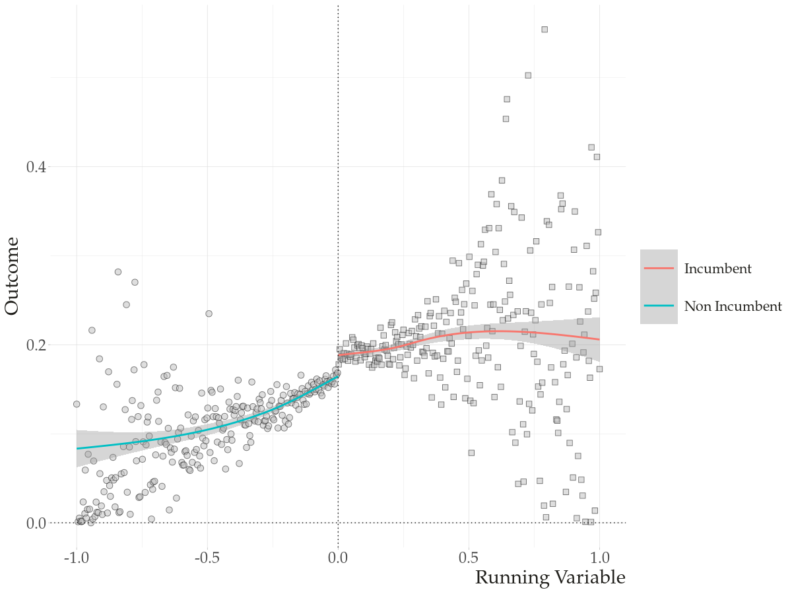
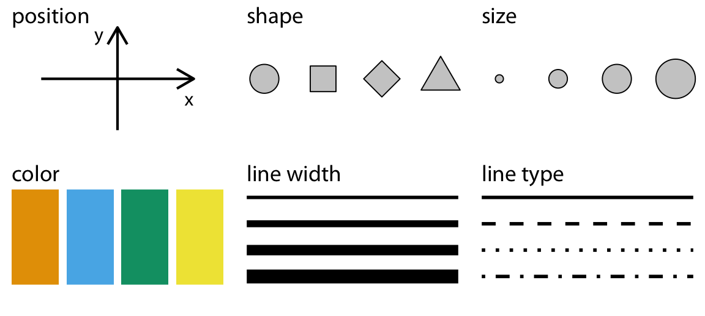
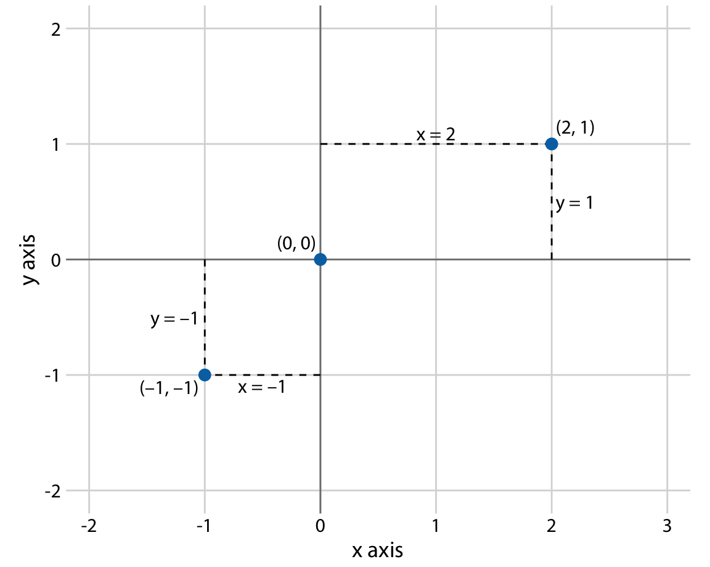
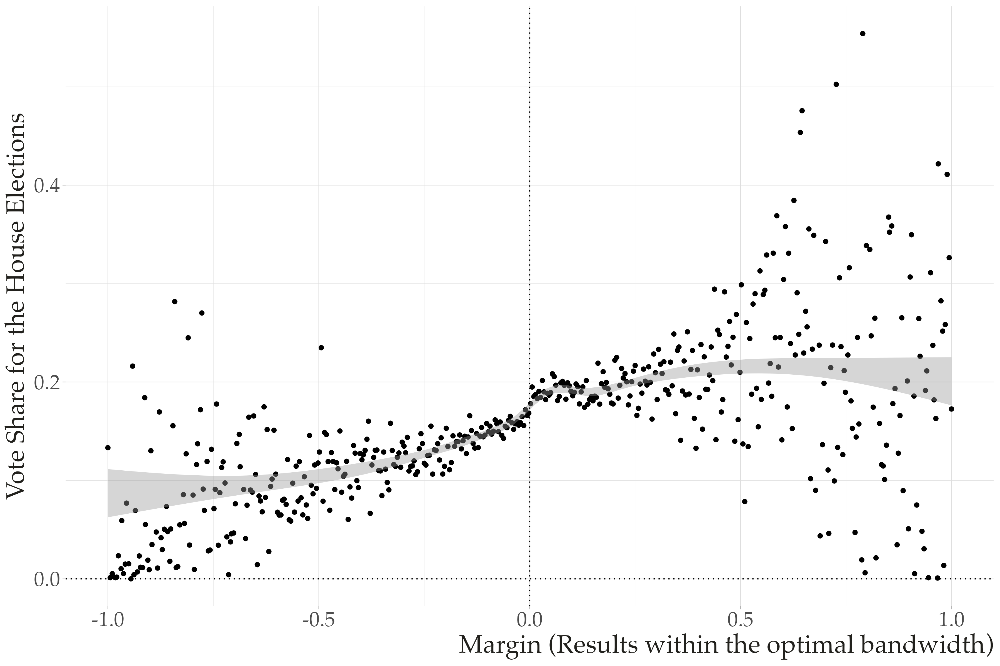
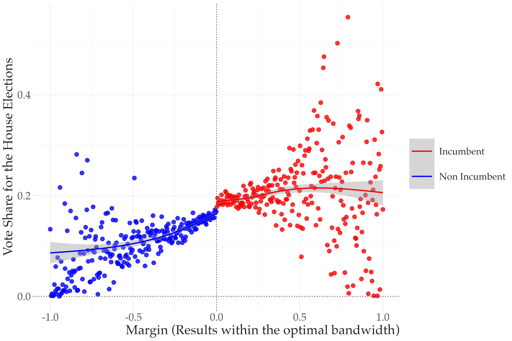
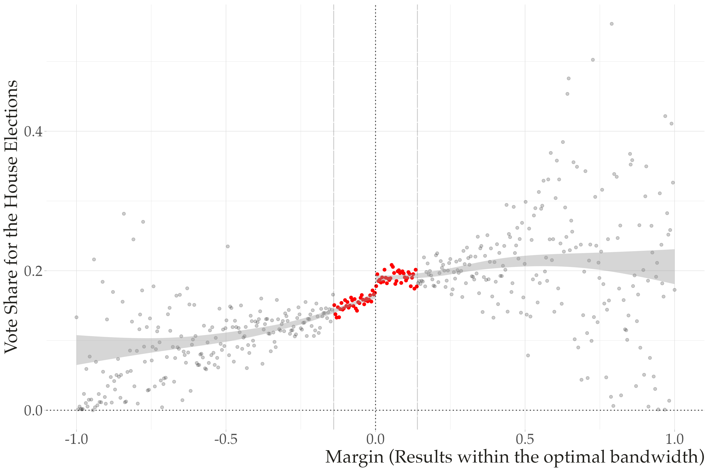
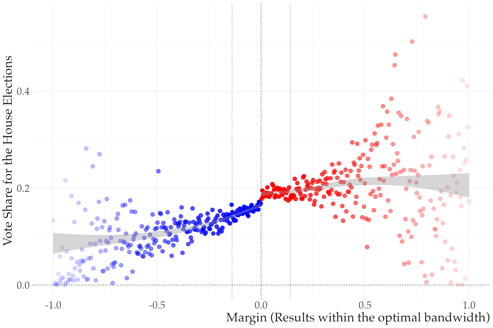

# Plans for Today

-   Data visualization: theory (grammar of graphics, aesthetics)

-   Data visualization: practice with `plotnine`

-   Data visualization: native Python libraries (`matplotlib`, `seaborn`)

-   Data types and a directory of common visualizations

-   In-class practice

## Why data visualization?

-   Visualization matters! A figure is almost always more compelling than a table or a crosstab

-   This course covers the basics; you'll have a full semester of Data Visualization later in the program

-   Focus of today:
    -   Grammar of graphics and `plotnine` (a `ggplot2` implementation in Python)
    -   A brief tour of the native Python libraries `matplotlib` and `seaborn`

# Data visualization in theory {background-color="#447099"}

## Quiz: what do you see?

::: {style="text-align: center;"}
{width=70%}
:::

-   How many variables (data) are mapped in this graph?
-   How are these **variables (non-constant)** represented in the figure?
-   What are the non-data (constant) related elements presented in the graph?

## Aesthetics

> All data visualizations map data values into quantifiable features of the resulting graphic. We refer to these features as aesthetics.
>
> --- *Fundamentals of Data Visualization*, Claus Wilke

**Aesthetics:** visual mappings that connect **data variables** to **visual attributes** of graphical elements

::: {style="text-align: center;"}
{width=65%}
:::

## Cartesian coordinates system: 2d

Humans can very easily understand information in two dimensions; most of our work will consist of mapping data onto an X and a Y axis

::: {style="text-align: center;"}
{width=55%}
:::

## Adding a 3rd, 4th, 5th variable in a 2d space

We often want to map more variables into the graph. For example, we might want to:

-   Distinguish discrete items or groups that don't have an intrinsic order
-   Highlight values that pass a certain threshold
-   Represent a sequential/continuous data value

To add these to a 2d graph, we map them to **new aesthetics** (color, shape, size, alpha...)

## Basic 2d plot

::: {style="text-align: center;"}
{width=65%}
:::

## Color aesthetics to distinguish

::: {style="text-align: center;"}
{width=65%}
:::

## Color aesthetics to highlight

::: {style="text-align: center;"}
{width=65%}
:::

## Color to represent a sequence of data points

::: {style="text-align: center;"}
{width=65%}
:::

## Grammar of graphics

**Grammar**: the set of structural rules that dictate how words in a language can be combined to form meaningful sentences

**Grammar of graphics**: brings a similar effort to establish structural rules for data visualizations --- first developed in Leland Wilkinson's book *The Grammar of Graphics*

**Implementation**:

-   `ggplot2` in R (developed by [Hadley Wickham](https://vita.had.co.nz/papers/layered-grammar.html))
-   `plotnine` in Python --- an emulator of `ggplot2`

Native Python libraries (`matplotlib`, `seaborn`) don't use this framework, but we'll focus on `plotnine` because it enforces a systematic, structured approach to building a wide variety of visualizations

## Major components of the grammar of graphics

`plotnine`/`ggplot2` graphs have three **key steps**:

-   **Data step**: the raw data you want to plot
-   **Geometries `geom_` step**: the geometric shapes that represent the data
-   **Aesthetics `aes()` step**: aesthetics of the geometric/statistical objects --- position, color, size, shape, transparency

## Additional components of the grammar of graphics

-   **Facets**: create subplots based on a specific variable
-   **Annotations**: labels, titles, subtitles, captions
-   **Coordinates & scales**: adjust the aesthetics you're mapping (colors, size, alpha, scale of x/y coordinates)
-   **Theme**: control finer presentation details --- font size, background color, grid line styles, etc.

# Data visualization in practice: `plotnine` {background-color="#447099"}

## Setup

```{python}
import pandas as pd
import numpy as np
import scipy.stats as stats  # for calculating quantiles for a QQ plot
import requests

# Print all columns from the Pandas DataFrame
pd.set_option('display.max_columns', None)

# Ignore warnings from Seaborn (future update warnings)
import warnings
warnings.filterwarnings("ignore")
```

## The gapminder dataset

Used in earlier lecture on `numpy`

For each of 142 countries, [gapminder](http://gapminder.org) provides values for life expectancy, GDP per capita, and population, every five years from 1952 to 2007

```{python}
import pandas as pd
import numpy as np
from plotnine import *          # ggplot functions
from gapminder import gapminder  # bring in the data

import warnings
warnings.filterwarnings('ignore')  # ignore warnings

gapminder.head()

import sys
print(sys.executable)
```

## Creating derived variables

```{python}
# create two new log variables
gapminder = (gapminder
       .assign(lngdpPercap = np.log(gapminder["gdpPercap"]),
               lnpop = np.log(gapminder["pop"]))
      )
```

## Three key steps with `plotnine`

### `ggplot`(data = `<DATA>`)

### `+`

### `geom_<representation>`(aes(`<aesthetics>`))

## Step 1-3 in action

Two differences from R syntax:

- Wrap entire expression in parantheses
- Variable names appear in quotes rather than unquoted

```{python}
# build a plotnine graph

# step 1: data
(ggplot(data=gapminder) +

# step 2: geom
 geom_point(

# step 3: aesthetics
     aes(x="lngdpPercap", y="lifeExp"))
)
```

## Changing the geometric representation

You can easily swap the geometry while keeping the same data/aesthetics

```{python}
# step 1: data
(ggplot(data=gapminder) +

# step 2: geom
 #geom_point
 geom_smooth(

# step 3: aesthetics
     aes(x="lngdpPercap", y="lifeExp"), method='lowess')
)
```

## Combining multiple geometric representations {.smaller}

```{python}
# step 1: data
(ggplot(data=gapminder) +

# step 2: geom
 geom_smooth(
# step 3: aesthetics
     aes(x="lngdpPercap", y="lifeExp"), method="lowess") +

# a second geometric representation, layered on top
geom_point(
     aes(x="lngdpPercap", y="lifeExp"))
)
```

## Aesthetics can be mapped to variables or to scalar values {.smaller}


```{python}
# step 1: data
(ggplot(data=gapminder) +

# step 2: geom
 geom_smooth(
# step 3: aesthetics as a variable
     aes(x="lngdpPercap", y="lifeExp", color="continent"),
     method = "lowess") +

# aesthetics as fixed values
geom_point(
     aes(x="lngdpPercap", y="lifeExp"),
    color="black",
    alpha=.1,
    size=2,
    shape="o")
)
```

## Putting it all together {.smaller}


```{python}
# step 1: data
(ggplot(data=gapminder) +

# step 2: geom
 geom_point(
     aes(x="lngdpPercap", y="lifeExp", color="continent"),
        alpha=.2, size=3) +

# step scale: manually edit the aesthetic's values
scale_color_manual(values = ["blue","steelblue","black","gold","pink"],
                  name="Continent") +

# step theme: change the overall look of the graph
theme_minimal(base_size=16) +

# step facet: break the graph into subplots
facet_wrap("continent", scales="free") +

# step labels: edit the labels of the graph
labs(x="Log GDP Per Capita", y="Life Expectancy",
     title="Gdp vs Life Expectancy Across the World")
)
```

## Do I need to memorize all of these options?

**No.** Learn the fundamental steps and how they fit together. When you need to build a graph:

-   Consult the [plotnine documentation](https://plotnine.readthedocs.io/en/stable/index.html) for guidance and tips on the API
-   Browse the [gallery](https://plotnine.readthedocs.io/en/stable/gallery.html) for graphs you'd like to replicate
-   Get ready to ask Google the same question over and over

# Native Python libraries: `matplotlib` + `seaborn` {background-color="#447099"}

## Why cover these too?

-   Outside `plotnine`, Python has its own native visualization tools
-   The most common are `matplotlib` and `seaborn` (built on top of `matplotlib`)
-   You'll frequently encounter them in other data scientists' code, so we'll cover them briefly

We'll use the same `gapminder` data throughout

## `matplotlib`

`matplotlib` builds plots in a few explicit steps:

-   **Step 1**: create the `plt.figure()` and `plt.axes()` objects
-   **Step 2**: create the visualization with a specific method on the `axes` object
-   **Step 3**: edit aesthetics with arguments inside those methods
-   **Step 4**: edit labels, titles, and overall annotations

```{python}
import matplotlib.pyplot as plt  # for plotting
import seaborn as sns            # for plotting

gapminder.head()
```

## `matplotlib` example

```{python}
# step 1: can be done with plt.subplots()
fig, ax = plt.subplots()

# step 2 + step 3
ax.scatter(x = gapminder["lngdpPercap"], y = gapminder["lifeExp"],
           c="green", alpha=.5, marker="*")

# step 4
ax.set_xlabel("Log GDP Percapita")
ax.set_ylabel("Life Expectancy")

plt.show()
```

## `.plt` makes some of these steps unnecessary

```{python}
# using .plt methods to avoid separate .axes and .figure calls
plt.figure(figsize=(8,4))
plt.scatter(x = gapminder["lngdpPercap"], y = gapminder["lifeExp"],
            c="green", alpha=.5, marker="*")
plt.xlabel("Log GDP perCapita")
plt.ylabel("Life Expectancy")
plt.show()
```

## `seaborn`

A higher-level, more attractive interface built on top of `matplotlib`

**Advantages**:

-   Graphs are visually more polished than base `matplotlib`
-   Built-in themes
-   Integrates seamlessly with pandas DataFrames

See the [seaborn tutorial](https://seaborn.pydata.org/tutorial/introduction.html)

## `seaborn` example

```{python}
sns.scatterplot(x = "lngdpPercap", y="lifeExp",
                alpha=.5,
                color="green",
                s=100,
                data = gapminder)
plt.xlabel("Log GDP perCapita")
plt.ylabel("Life Expectancy")
plt.show()
```

**Notice:** the data comes in as an argument, and variables are referenced as strings --- otherwise very similar to `matplotlib`

# Data types and a directory of visualizations {background-color="#447099"}

## Data types drive visualization decisions

| Data Type   | Example               | Scale                                                      |
|:-----------:|:----------------------:|:------------------------------------------------------------:|
| Numerical   | 1.3, 800, 10e3         | Continuous                                                  |
| Integer     | 1, 2, 3                | Discrete (small $n$), Continuous (large $n$)                |
| Categorical | "dog", "Nigeria", "A"  | Discrete                                                    |
| Ordered     | "Small", "Medium", "Large" | Discrete                                                |
| Dates/Time  | 2009-01-02, 5:32:33    | Continuous                                                  |

## Discrete values {.smaller}

::: columns
::: {.column width="50%"}
{width=90%}
:::
::: {.column width="50%"}
{width=90%}
:::
:::

## Continuous values

::: {style="text-align: center;"}
{width=55%}
:::

## Relationships {.smaller}

::: columns
::: {.column width="50%"}
{width=90%}
:::
::: {.column width="50%"}
{width=90%}
:::
:::

# Discrete values in practice {background-color="#447099"}

## Univariate discrete categorical data: bar plots

```{python}
# plotnine
(ggplot(gapminder,aes(x='continent')) +
  geom_bar() +
  ylab("Number of observations")) 
```

## Adding in more categorical data

```{python}
# create a binary indicator for wealthy countries
gapminder = (gapminder.
                assign(wealthy=np.where(gapminder["lngdpPercap"] > 9,"yes","no")
                      )
            )

(ggplot(gapminder,aes(x='continent',fill='wealthy')) +
  geom_bar() +
  scale_x_discrete(limits=["Africa", "Americas", "Asia", "Europe", "Oceania"]) +
  ylab("Number of observations"))
```

## Dodge the bars + edit colors manually

```{python}
(ggplot(gapminder,aes(x='continent',fill='wealthy')) +
  geom_bar(position="dodge", color="black") +
  scale_x_discrete(limits=["Africa", "Americas", "Asia", "Europe", "Oceania"]) +
  scale_fill_manual(values=["yellow", "red"],
                    limits=["yes", "no"],
                    labels=["Yes", "No"],
                    name="Wealthy?") +
  ylab("Number of observations")
)
```

## The same bar plot, in `seaborn`

```{python}
# Create the bar plot
palette = {"yes": "yellow", "no": "red"}

sns.catplot(x="continent", hue = "wealthy",
            data=gapminder,
            kind="count",
            palette=palette,
            dodge=True,
            edgecolor="black")

# set legend title
plt.legend(title="Wealthy?")
```


# In-class Activity {background-color="#449998"}

See Activity 1, 2, and 3 in notebook

# Appendix with Additional Plot Types {background-color="#449998"}


## Point + uncertainty, in `plotnine`

```{python}
# calculate the means and standard errors for lifeExp grouped by continent
grouped = gapminder.groupby('continent')['lifeExp'].agg(['mean', 'std']).reset_index()
grouped['ymin'] = grouped['mean'] - grouped['std']
grouped['ymax'] = grouped['mean'] + grouped['std']

(ggplot(grouped, aes(x='continent', y='mean'))
     + geom_point(color="red", size=3)
     + geom_errorbar(aes( ymin='ymin', ymax='ymax'), width=.2, size=1.2)
)
```

## Point + uncertainty, in `seaborn`

```{python}
sns.catplot(x="continent",
            y="lifeExp",
            data=gapminder,
            kind="point",
            join=False)  # discuss the difference between join=True and join=False
```

# Bivariate: category on continuous {background-color="#447099"}

## Box plot

```{python}
# plotnine
(ggplot(gapminder,aes(x='continent',y = 'lifeExp')) +
  geom_boxplot() +
  coord_flip())
```

## Box plot

```{python}
# seaborn
sns.boxplot(y='continent',x = 'lifeExp',data=gapminder)
```

## Violin plot

```{python}
# plotnine
(ggplot(gapminder,aes(x='continent',y = 'lifeExp')) +
    geom_violin())
```

## Violin plot

```{python}
# seaborn
sns.violinplot(x='continent',y = 'lifeExp',data=gapminder)
```

## Jitter plot

```{python}
(ggplot(gapminder,aes(x='continent',y = 'lifeExp',color="continent")) +
  geom_jitter(width = .25,alpha=.5,show_legend=False))
```

## Layering representations: jitter + box plot {.smaller}

```{python}
# plotnine
(ggplot(gapminder,aes(x='continent',y = 'lifeExp',color="continent")) +
  geom_jitter(width = .1,alpha=.1,show_legend=False) +
  geom_boxplot(alpha=.5,show_legend=False))
```

## Layering representations: jitter + box plot {.smaller}

```{python}
# seaborn
color = {"Asia": "blue",
         "Europe": "red",
         "Africa": "yellow",
         "Americas":"green",
         "Oceania":"gray"}

# boxplot
sns.boxplot(x='continent',y = 'lifeExp',
            hue="continent",
            palette=color,
            data=gapminder)
# jitter
sns.stripplot(x='continent', y='lifeExp',
              data=gapminder, jitter=True,
              alpha=0.1, hue="continent",
             palette=color)

plt.legend([], [], frameon=False)
```

# Continuous values in practice {background-color="#447099"}

## Histogram

```{python}
# plotnine/ggplot2
(ggplot(gapminder, aes(x = 'lifeExp')) +
  geom_histogram(bins=100))
```

## Histogram

```{python}
# seaborn
sns.distplot(gapminder.lifeExp,hist=True,kde=True)
```

## Density

```{python}
# plotnine/ggplot2
(ggplot(gapminder, aes(x = 'lifeExp')) +
  geom_density(fill="blue",color="black",alpha=.5)+
  xlim(0,100))
```

## Density, faceted by group

```{python}
# plotnine/ggplot2
(ggplot(gapminder, aes(x = 'lifeExp', fill="continent")) +
  geom_density(color="black",alpha=.5)+
  xlim(0,100) +
  facet_grid(" ~ continent"))
```

## Density, faceted by group

```{python}
# seaborn
sns.kdeplot(gapminder.lifeExp,shade=True)
```

# Relationships in practice {background-color="#447099"}

## Scatterplot

```{python}
# plotnine/ggplot2
(ggplot(gapminder, aes(x = 'lngdpPercap', y = 'lifeExp')) +
  geom_point(alpha=.5))
```

## Scatterplot

```{python}
# seaborn
sns.scatterplot(x = 'lngdpPercap', y = 'lifeExp',data=gapminder)
```

## Line plot

```{python}
# plotnine/ggplot2
(ggplot(gapminder, aes(x = 'lngdpPercap', y = 'lifeExp')) +
  geom_line())
```

## Line plot

```{python}
# seaborn
sns.lineplot(x = 'lngdpPercap', y = 'lifeExp',data=gapminder)
```

## Easily add a smoother in `plotnine`

```{python}
(ggplot(gapminder, aes(x = 'lngdpPercap', y = 'lifeExp')) +
   geom_point(alpha=.2)
    + geom_smooth(method="lowess"))
```


