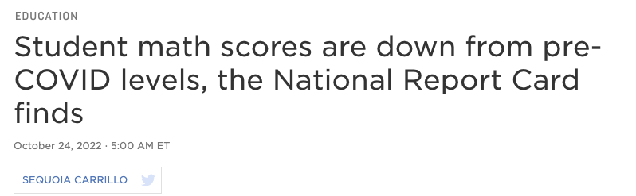
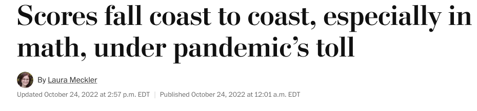
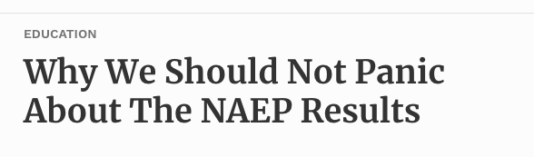
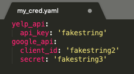
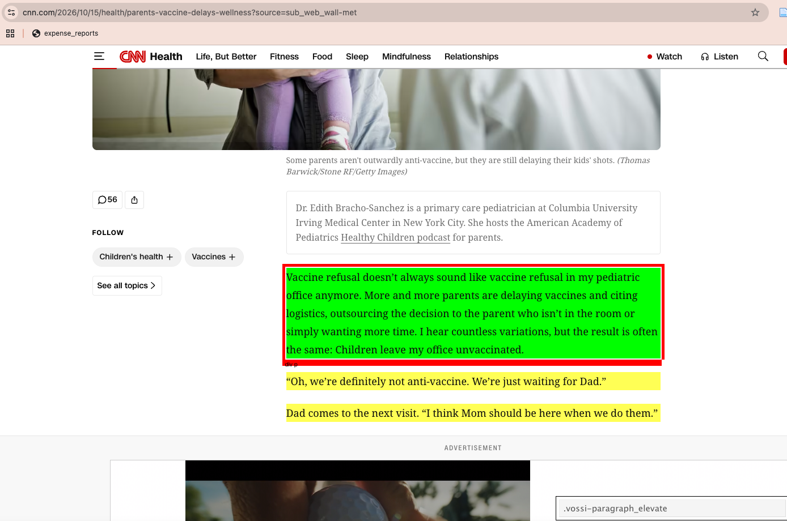

# Plans for Today

-   Three routes to acquiring data

-   APIs: terminology and basics

-   APIs in practice: three examples

    -   No credentials and no wrapper (NAEP data API)
    -   Credentials and no wrapper (Yelp API)
    -   Credentials and a wrapper (Census API via the `census` package)

-   Scraping static websites with `requests` and `BeautifulSoup`


## Setup

```{python}
import pandas as pd
import numpy as np
import requests                  # for calling APIs and downloading websites
import yaml                      # for loading credentials
from bs4 import BeautifulSoup    # for parsing html
import time                      # to put the system to sleep
import random                    # for random numbers
import re                        # regular expressions

pd.set_option('display.max_columns', None)

import warnings
warnings.filterwarnings("ignore")
```

# Acquiring data {background-color="#447099"}

## Three general routes to acquiring data

::: columns
::: {.column width="30%"}
**Exists already**

csv or excel data like we've been working with for problem sets
:::

::: {.column width="35%"}
**API**

Use code (rather than point and click) to create data or flat files; most relevant for "high-velocity" data that changes frequently (e.g., social media posts; job postings)
:::

::: {.column width="35%"}
**Scraping**

APIs are a "front door" to a website: developers provide an easy way to get content but also set limits (what content you can get; how much you can pull in a given period)

Scraping is a "back door" for when there's no API or when we need content beyond the structured fields the API returns
:::
:::

## Why go through the effort to use data that doesn't exist already?

-   Guarantees that you're working with original data $\implies$ research question is likely novel

-   Study rapidly changing phenomena missed in static flat files

-   **Rule of thumb:** if you can use an API to access a dataset, that's where you will want to go --- APIs are developed by the data owners, so they're often more secure, practical, and organized than scraping

# APIs: terminology and basics {background-color="#447099"}

## Terminology

-   **API:** application programming interface; a way to ask an app or website for something and get something in return

-   **Call the API:** sending a request for something to the API

-   **Response:** a message back telling us *whether* we got something back or whether the call returned an error

-   **JSON:** if we get something back, it's often stored in `json` format --- a text string with a structure similar to the *data structure* of a dictionary; pretty easy to convert to a `pandas` DataFrame

-   **Wrapper:** a language-specific module or package that simplifies calling an API from that language (e.g., `census` is a Python wrapper for the Census Bureau's API)

## Three examples we'll walk through

-   API with no credentials and no wrapper (NAEP data API)
-   API with credentials and no wrapper (Yelp API)
-   API with credentials and a wrapper (Census API via the `census` package)

# Example 1: API with no credentials and no wrapper (NAEP) {background-color="#447099"}

## NAEP in the news

::: {style="text-align: center;"}
{width=60%}

{width=60%}

{width=60%}
:::

## High-level overview of steps: APIs that don't need credentials

1.  Construct a query that tells the API what we want to pull
2.  Use `requests.get(querystring)` to call the API
3.  Examine the response: a message from the API telling us whether it returned something
4.  If the response returned something, extract the content of the response and make it usable

## Step 1: construct a query

**Generic example:**

<span style="color:#9932CC;">https://baseurl.com/</span><span style="color:red;">onething=something&</span><span style="color:blue;">anotherthing=somethingelse</span>

**Specific NAEP example** (wrap in parentheses to split the string across lines):

```{python}
example_naep_query = (
    'https://www.nationsreportcard.gov/'
    'Dataservice/GetAdhocData.aspx?'
    'type=data&subject=writing&grade=8&'
    'subscale=WRIRP&variable=GENDER&'
    'jurisdiction=NP&stattype=MN:MN&'
    'Year=2011')

example_naep_query
```

**Breaking things down:**

-   `nationsreportcard...GetAdhocData.aspx?`: the "base url" we add parameters to
-   `subject`: type of parameter
-   `subject=writing`: specific value for that parameter (error if we feed it a subject that doesn't exist)
-   And so on...

## Step 2: call the API

```{python}
## use requests.get to call the API
naep_resp = requests.get(example_naep_query)

## examine the response
naep_resp
```

## Steps 3-4: if the response indicates something usable, extract content

```{python}
## we got a usable response, so get json of status and result
naep_resp_j = naep_resp.json()
naep_resp_j.keys()
```

```{python}
## extract contents in 'result' key
## and convert to dataframe
naep_resp_d = pd.DataFrame(naep_resp_j['result'])
naep_resp_d[['year', 'jurisLabel', 'variableLabel', 'varValueLabel', 'value']]
```

## What do I mean by "no wrapper"?

-   We write a query to request something from the API
-   While the request syntax differs across languages, the query is the same --- e.g., could use the same query and run the `R` code below to get the content

```r
## packages
library(httr)
library(jsonlite)

## ping API
return_q = GET(example_naep_query)

## get data from that ping
data = fromJSON(rawToChar(return_q$content))$result
```

## In-class activity {background-color="#449998"}

See Activity 1 in notebook


# Example 2: API with credentials and no wrapper (Yelp) {background-color="#447099"}

## What changes about the general steps?

1.  <span style="color:#9932CC;">**Acquire credentials for the API:** these may be an API key (single string) or a client ID and secret (strings); can store in a `yaml` credentials file</span>
2.  Construct a query that tells the API what we want to pull
3.  <span style="color:#9932CC;">**Two paths:**</span>
    a.  **Use credentials to authenticate and then call the API:** we'll see an example of this with the Census API/wrapper
    b.  **Feed the API your credentials when you call it:** we'll see an example of this with Yelp
4.  Examine the response: a message from the API telling us whether it returned something
5.  If the response returned something, extract the content of the response and make it usable

## Step 1: acquire credentials

-   Varies across APIs, but generally involves going to the "developer's portal," creating an account, and obtaining credentials
-   Examples:
    -   Google developer's console (e.g., geocoding API; maps API): <https://console.cloud.google.com>
    -   Facebook: <https://developers.facebook.com/docs/development>
    -   Census Bureau: <https://api.census.gov/data/key_signup.html>
    -   Yelp: <https://business.yelp.com/data/products/fusion/>
-   Terminology is a bit odd for social science applications: you often set up "an application" to get credentials, even though we're usually doing a one-way pull of data rather than developing an app

## Step 1: store those credentials somewhere

-   Your key or client ID/secret are meant to be unique to you, like a password, so you generally shouldn't print them in code
-   Can use any text editor to make a `yaml` file (structured similar to a dictionary); screenshot below with fake credentials

::: {style="text-align: center;"}
{width=40%}
:::

## Step 1: load the file with credentials

```{python}
## load creds
with open("../creds.yaml", 'r') as stream:
    try:
        creds = yaml.safe_load(stream)
    except yaml.YAMLError as exc:
        print(exc)

## can then get the relevant key
API_KEY = creds['yelp_api']['api_key']
```

## Step 2: construct a query

- Same process as before
- Focus on the **Yelp Fusion API**. 
- We'll initially rfocus on focus on Business Search, since that returns a Yelp-specific ID:  [documentation](https://docs.developer.yelp.com/reference/v3_business_search)


## Step 2: construct a query

```{python}
## defining inputs
base_url = "https://api.yelp.com/v3/businesses/search?"
my_name = "restaurants"
my_location = "Washington,DC,20001"

## combining them into a query
yelp_genquery = (
    '{base_url}'
    'term={name}'
    '&location={loc}').format(
            base_url = base_url,
            name = my_name,
            loc = my_location)

yelp_genquery
```

## Step 3: authenticate and call the API

For Yelp, we feed a dictionary with our key directly into the `get` call via the optional `headers` parameter; for other APIs, we sometimes authenticate in a separate step

```{python}
## construct my http header dict
header = {'Authorization': f'Bearer {API_KEY}'}

## call the API
yelp_genresp = requests.get(yelp_genquery, headers = header)
```

**Output of a successful call:**

```
<Response [200]>
```

**Output of an unsuccessful call:**

```
<Response [400]>
```

## Step 4: if output successful, make results usable

```{python}
yelp_genjson = yelp_genresp.json()
yelp_genjson['businesses'][0:2]
```

The `businesses` key of the json has a dictionary for each business, but with some nesting to deal with variable lengths (e.g., within `location`: `address1`, `address2`, etc.) that might produce odd things when we convert to a DataFrame


## Two approaches to step 4

**Approach 1:** more automatic conversion that leaves nested fields as lists/dictionaries

```{python}
yelp_gendf = pd.DataFrame(yelp_genjson['businesses'])
yelp_gendf.head(3)
```

## Two approaches to step 4

**Approach 2:** only retaining columns that are already strings

Can also make more complicated function that formats specific, non-string keys like the business hours to a more intuitive column format

```{python}
def clean_yelp_json(one_biz):
    ## restrict to str cols
    d_str = {key:value for key, value in one_biz.items() if type(value) == str}
    df_str = pd.DataFrame(d_str, index = [d_str['id']])
    return(df_str)

yelp_stronly = [clean_yelp_json(one_b)
                for one_b in yelp_genjson['businesses']]
yelp_stronly_df = pd.concat(yelp_stronly)
yelp_stronly_df.head(3)
```

## In-class activity {background-color="#449998"}

See Activity 2 in notebook


# Example 3: API with credentials and a wrapper (Census) {background-color="#447099"}

## Why Census data?

-   The **American Community Survey (ACS)** is the Census Bureau's ongoing survey of ~3.5 million addresses per year; it's the main source of detailed data on income, poverty, housing, education, language, and more
-   Available for many **geographies**: nation, states, counties, census tracts, and smaller
-   Used to allocate federal funding, draw districts, and in countless policy evaluations --- and it's a very common "right-hand side" dataset to merge onto your own data
-   Two common versions:
    -   **ACS 1-year:** more current, but only for areas with 65,000+ people
    -   **ACS 5-year:** pooled over five years; available down to small geographies like tracts

## The Census API and the `census` wrapper

-   **API:** <https://api.census.gov> --- requires a free API key 
-   **Wrapper:** the [`census` package](https://pypi.org/project/census/) (developed by DataMade)
-   Recall our earlier steps for NAEP and Yelp:
    1.  Set up credentials (where relevant)
    2.  Constructed a query based on the API documentation
    3.  Used `requests.get(query)` to call the API
    4.  Got a response
    5.  Extracted the content of the response and turned it into usable data
-   The wrapper simplifies <span style="color:#9932CC;">**steps 2-5**</span>: instead of a long query string, we call methods that name the dataset and geography we want, and get back data that's easy to convert to a DataFrame
-   **Downside:** we need to learn the wrapper's methods (but this is often easier than constructing queries ourselves)

## Step 1: acquire and store credentials

-   Request a key here: <https://api.census.gov/data/key_signup.html> --- it arrives by email; you need to click the link in the email to activate it
-   Add it to your `yaml` credentials file, e.g.:

```yaml
census_api:
  api_key: 'YOUR_KEY_HERE'
```

-   Load it the same way as the Yelp key:

```{python}
with open("../creds.yaml", 'r') as stream:
    creds = yaml.safe_load(stream)

CENSUS_KEY = creds['census_api']['api_key']
```

## Step 2: find the variables you want

-   ACS variables have codes like `B19013_001E`:
    -   `B19013`: the table (median household income)
    -   `_001`: the line within the table
    -   `E`: estimate (vs. `M` for margin of error)
-   Search the variable list for a dataset and year: <https://api.census.gov/data/2024/acs/acs5/variables.html>
-   Some variables we'll use:

| Variable | Description |
|:---|:---|
| `NAME` | Name of the geography |
| `B01003_001E` | Total population |
| `B19013_001E` | Median household income |
| `B17001_001E` | Population for whom poverty status is determined |
| `B17001_002E` | Population with income below the poverty level |

## Without a wrapper: same structure as NAEP

```{python}
## construct the query
census_query = (
    'https://api.census.gov/data/2024/acs/acs5?'
    'get=NAME,B19013_001E&'
    'for=county:*&in=state:24&'
    f'key={CENSUS_KEY}')

## call the API
census_resp = requests.get(census_query)

## the json is a list of lists; the first list is the column names
census_json = census_resp.json()
md_income_raw = pd.DataFrame(census_json[1:], columns = census_json[0])
md_income_raw.head()
```
## Without a wrapper: same structure as NAEP

```python
## construct the query
census_query = (
    'https://api.census.gov/data/2024/acs/acs5?'
    'get=NAME,B19013_001E&'
    'for=county:*&in=state:24&'
    f'key={CENSUS_KEY}')
```

-   Notice that the query has to encode the **dataset** (`2024/acs/acs5`), the **variables** (`get=`), and the **geography** (`for=` and `in=`)
-   Values come back as strings, so we'd still need to convert them to numbers

## With a wrapper: install and connect


```{python}
from census import Census
from us import states

## use the key to create a connection to the API
c = Census(CENSUS_KEY)
```

-   `Census(CENSUS_KEY)`: creates a client object that stores our key, so we don't need to add it to each call
-   `us`: a helper package with state names and FIPS codes (e.g., `states.MD.fips` returns `'24'`)
-   The client has an attribute for each dataset, e.g. `c.acs5`, `c.acs1`, `c.acs5dp` (data profiles), and `c.pl` (redistricting data)
-   Each dataset has methods for each geography, e.g. `.state()`, `.state_county()`, `.state_county_tract()`

## Same query as before, using the wrapper

```{python}
md_income = c.acs5.state_county(fields = ('NAME', 'B19013_001E'),
                                state_fips = states.MD.fips,
                                county_fips = Census.ALL)
                                
```


**Breaking things down:**

-   `c.acs5`: the dataset (ACS 5-year; defaults to the most recent year)
-   `.state_county()`: the geography (counties within a state)
-   `fields`: tuple of variables we want
-   `state_fips`: which state
-   `county_fips = Census.ALL`: all counties in that state (`Census.ALL` is the wrapper's version of `*` in the raw query)

## Same query as before, using the wrapper

```{python}
md_income_df = pd.DataFrame(md_income)
md_income_df.head()
```

-   Returns a list of dictionaries (one per county) that converts directly to a DataFrame


## Examples of three things we can do

1.  **Pull a variable for every state**
2.  <span style="color:gray;">Pull several variables for counties and construct new measures</span>
3.  <span style="color:gray;">Pull small-area (tract) data and build join keys to merge with other data</span>

## Task 1: pull a variable for every state

```{python}
## pull total population and median household income for all states
state_data = c.acs5.state(fields = ('NAME', 'B01003_001E', 'B19013_001E'),
                          state_fips = Census.ALL)

state_df = (pd.DataFrame(state_data)
            .rename(columns = {'B01003_001E': 'total_pop',
                               'B19013_001E': 'median_hh_income'})
            .sort_values(by = 'median_hh_income', ascending = False))

state_df.head()
```

-   Can pull an earlier year with the `year` argument --- e.g., `c.acs5.state(..., year = 2019)`
-   Can use the same code with `c.acs1` for more recent estimates (only for larger geographies)

## Examples of three things we can do

1.  <span style="color:gray;">Pull a variable for every state</span>
2.  **Pull several variables for counties and construct new measures**
3.  <span style="color:gray;">Pull small-area (tract) data and build join keys to merge with other data</span>

## Task 2: pull county data and construct a poverty rate {.smaller}

```{python}
## variables to pull, with readable names
county_vars = {'NAME': 'name',
               'B01003_001E': 'total_pop',
               'B19013_001E': 'median_hh_income',
               'B17001_001E': 'pov_universe',
               'B17001_002E': 'pov_below'}

## pull for all counties in Maryland
md_counties = c.acs5.state_county(fields = tuple(county_vars.keys()),
                                  state_fips = states.MD.fips,
                                  county_fips = Census.ALL)

## convert to a dataframe, rename, and construct poverty rate
md_counties_df = (pd.DataFrame(md_counties)
                  .rename(columns = county_vars)
                  .assign(pov_rate = lambda df: df.pov_below / df.pov_universe)
                  .sort_values(by = 'pov_rate', ascending = False))

md_counties_df[['name', 'total_pop', 'median_hh_income', 'pov_rate']].head()
```

-   Storing variable codes and readable names in a **dictionary** lets us use the keys to pull the data and the whole dictionary to rename
-   Why use the poverty "universe" as the denominator rather than total population? Poverty status isn't determined for everyone (e.g., people in college dorms or institutions)

## Examples of three things we can do

1.  <span style="color:gray;">Pull a variable for every state</span>
2.  <span style="color:gray;">Pull several variables for counties and construct new measures</span>
3.  **Pull small-area (tract) data and build join keys to merge with other data**

## Task 3: pull tract-level data {.smaller}

```{python}
## DC has a single county-equivalent with FIPS code 001
dc_tracts = c.acs5.state_county_tract(fields = tuple(county_vars.keys()),
                                      state_fips = states.DC.fips,
                                      county_fips = '001',
                                      tract = Census.ALL)

dc_tracts_df = (pd.DataFrame(dc_tracts)
                .rename(columns = county_vars))

## the census uses large negative numbers to flag values
## that can't be computed (e.g., median income for a tract with few households)
dc_tracts_df['median_hh_income'] = np.where(dc_tracts_df.median_hh_income < 0,
                                            np.nan,
                                            dc_tracts_df.median_hh_income)
```

-   Always check for these **sentinel values** (e.g., `-666666666`) before summarizing --- otherwise they'll drag down means dramatically

## Task 3: build a join key

```{python}
## the geography columns come back as strings with leading zeros
dc_tracts_df[['state', 'county', 'tract']].head()

## combine into the standard 11-digit tract GEOID
dc_tracts_df['GEOID'] = (dc_tracts_df.state +
                         dc_tracts_df.county +
                         dc_tracts_df.tract)
```

-   The **GEOID** (state + county + tract FIPS codes) is the standard key for merging Census data onto other datasets (e.g., school locations; crime incidents geocoded to tracts; shapefiles for mapping)
-   Recall the merge diagnostics from week 7: keep these codes as **strings** --- converting to integers strips leading zeros (e.g., Alabama's state FIPS is `01`) and leads to failed merges

## In-class activity {background-color="#449998"}

See Activity 3 in notebook


# Scraping static websites {background-color="#447099"}

## What is scraping?

**Scraping:** automatically collecting data available on websites. In theory, you could collect website data by hand --- but in a world of abundant data, this is rarely feasible

Examples of websites that have been scraped for research:

-   Electoral data from many different countries
-   Composition of elites around the world
-   Wikipedia
-   Political manifestos
-   Fact-checking news
-   Property prices from Zillow

Scraping can be summarized as:

-   Leveraging the structure of a website to **grab its contents**
-   Using a programming environment (such as R, Python, Java, etc.) to **systematically extract** that content
-   Accomplishing the above in an "unobtrusive" and **legal** way

## Ethical challenges with scraping

Web scraping is legal **as long as the scraped data is publicly available and the scraping activity does not harm the website being scraped** --- two hugely relevant conditions

-   Each call to a web server takes time, server cycles, and memory; massive automated requests can overload a site, taking it offline or causing the site administrator to ban your IP (see [denial-of-service attack](https://en.wikipedia.org/wiki/Denial-of-service_attack))
-   Best practice: only collect public information (e.g., public posts are OK; content from private groups where members expect privacy is not)

**Good practices for scraping:**

-   Respect `robots.txt`
-   Don't hit servers too often; slow your code down to the speed a human would browse
-   Find trusted source sites
-   Avoid scraping during peak hours
-   Use data responsibly

## Scraping routine

-   **Step 1:** Find a website with information you want to collect
-   **Step 2:** Understand the website
-   **Step 3:** Write code to collect one realization of the data
-   **Step 4:** Build a scraper --- generalize your code into a function

And repeat!

## Step 1: find a website... but what is a website?

A website is generally a combination of **HTML, CSS, XML, PHP, and JavaScript**. We will care mostly about HTML and CSS

**Static vs. dynamic websites:**

-   **Static websites:** built with HTML --- everything you see is in the source behind the website
-   **Dynamic websites:** produced by JavaScript --- sites you browse and click on where the url doesn't change; typically powered by a database deep within the programming

Today we focus on static websites using the Python library `BeautifulSoup`; I can share resources for dynamic website scraping using `Selenium`

## HTML

**HTML** = **HyperText Markup Language**: a markup language used to create web pages (not a programming language like Python, R, or Java). Web browsers read HTML documents and render them into visible web pages

```html
<html>
<head>
  <title> Michael Cohen's Email </title>
  <script>
    var foot = bar;
  <script>
</head>
<body>
  <div id="payments">
  <h2>Second heading</h2>
  <p class='slick'>information about <br/><i>payments</i></p>
  <p>Just <a href="http://www.google.com">google it!</a></p>
</body>
</html>
```

## HTML tags

HTML code is structured using tags, and information is organized hierarchically from top to bottom

Some of the most important tags for scraping:

-   `p` -- paragraphs
-   `a href` -- links
-   `div` -- divisions
-   `h` -- headings
-   `table` -- tables

See [here for more about html tags](https://betterprogramming.pub/understanding-html-basics-for-web-scraping-ae351ee0b3f9)

::: {style="background-color:#f8d7da; padding:20px; font-size:120%; text-align:center;"}
Scraping is all about finding tags and collecting the data associated with them
:::

## What else exists in HTML beyond tags?

The tags are the target. The information we need usually comes from the **text** and **attributes** of the tag --- very often, your work will consist of finding the tag and then capturing the information you need

::: {style="text-align: center;"}
{width=55%}
:::

::: {style="text-align: right;"}
**Source:** [semrush](https://www.semrush.com/blog/html-anchor/)
:::

## Step 2: understand the website

A huge part of scraping is understanding your website and finding the tags/information you're interested in. Two ways to go about it:

-   **Inspect the website:** `command` + `shift` + `i`, or select an element, right click, and choose Inspect
    -   See [an example in practice](https://storage.googleapis.com/lds-media/documents/css_selector_vs_xpath.mp4) (*Source: Ultimate Guide to Web Scraping with Python by Brenda Marting*)
-   **Use SelectorGadget:** a tool that lets us use CSS selectors to scrape websites
    -   See the [documentation](https://selectorgadget.com/) and a [tutorial](https://www.youtube.com/watch?v=YdIWI6K64zo)

## Break: install SelectorGadget {background-color="#449998"}

[SelectorGadget Chrome extension](https://chromewebstore.google.com/detail/selectorgadget/mhjhnkcfbdhnjickkkdbjoemdmbfginb)

## Step 3: collect a realization of the data

Two main libraries:

-   `requests`: to make a `get()` request and access the html behind the pages
-   `BeautifulSoup`: to parse the html

See this [tutorial](https://realpython.com/python-web-scraping-practical-introduction/) on the difference between parsing html with `BeautifulSoup` and using text-mining methods to scrape a website

## Example: CNN --- get request to collect html data

```{python}
# get access to the website
url = "https://www.cnn.com/2026/10/15/health/parents-vaccine-delays-wellness?source=sub_web_wall-met"
page = requests.get(url)

# check object type - object class requests
type(page)
```

```{python}
# check if you got a connection
page.status_code # 200 == connection
```

```{python}
# see the content
# notice we downloaded the entire website
page.content[0:500]
```

## Saving and loading html locally

After we make a request and retrieve a web page's content, we can store it locally with Python's `open()` function --- saving the html source avoids hitting the website multiple times

```{python}
#| eval: false
# save html locally
with open("../datasets/cnn_example_article", 'wb') as f:
    f.write(page.content)
```

```{python}
# open a locally saved html
with open("../datasets/cnn_example_article", 'rb') as f:
    html = f.read()

# see it
print(html[0:500])
```

## Here comes `BeautifulSoup`

A `BeautifulSoup` object is a parser: it lets us easily access elements from the raw html

```{python}
# create a bs object
# input 1: request content; input 2: tell it you need an html parser
soup = BeautifulSoup(page.content, 'html.parser')

# look at the raw code of the downloaded website
print(soup.prettify()[:1000])
```

## Here comes `BeautifulSoup`

The functions we'll use the most:

-   `.find_all()`: to find tags by their names
-   `.select()`: to select tags using a CSS selector
-   `.get_text()`: to access the text in the tag
-   `["attr"]`: to access attributes of a tag

## Grabbing the text of the story

The text of a story is often under the tag `<p>` for paragraph

```{python}
## find paragraphs
cnn_par = soup.find_all('p')
len(cnn_par)
```

```{python}
## first paragraph
cnn_par[0]
```

```{python}
## last paragraph
cnn_par[-1]
```

## Removing html tags with `.get_text()`

```{python}
# get the text f the first paragraph
# this is what is in between the tags <p> TEXT </p>
cnn_par[0].get_text()
```

```{python}
# use our friend list comprehension to parse all
all_par = [par.get_text() for par in cnn_par]
all_par[-3:]
```

We collected some paragraphs at the bottom that aren't the story text: `<p>` is used in multiple places on the page --- e.g., the last element is the page footer

## Solution: be more specific with a CSS selector

-   A **CSS selector** is a pattern used to select and style one or more elements in an HTML document --- a way to chain multiple styles and attributes of an html file
-   Another option is XPATH, which can be super useful to learn but is a bit more complicated for beginners
-   See this [tutorial](https://developer.mozilla.org/en-US/docs/Learn/CSS/Building_blocks/Selectors) to understand the concept of a CSS selector

## Solution: be more specific with a CSS selector

::: {style="text-align: center;"}
{width=60%}
:::

## Solution: be more specific with a CSS selector

```{python}

# use a css selector to target specific content
cnn_par = soup.select(".vossi-paragraph_elevate")
cnn_par[-1]
```

## Cleaning the story text

```{python}
story_content = [i.get_text() for i in cnn_par]
story_content[0].strip()
```

```{python}
# clean and join together with string methods
story_text = "\n".join([i.strip() for i in story_content])
print(story_text[0:1000])
```

## What else can we collect from this story? Title, date, and author

```{python}
# title
css_loc = "#maincontent"
story_title = soup.select(css_loc)[0].get_text()
print(story_title.strip())
```

```{python}
# story date
story_date = soup.select(".vossi-timestamp_elevate")[0].get_text()
print(story_date.strip())
```

```{python}
# story authors
story_author = soup.select(".vossi-byline_elevate__authors")[0].get_text()
print(story_author.strip())
```

## Step 4: build a scraper {.smaller}

Once your scraper works for a single case, generalize it by creating a function --- and build in good practices that imitate human behavior

```{python}
def cnn_scraper(url=None):
    '''
    this function scrapes relevant content from the cnn website
    input: str, url from cnn
    '''
    # get access to the website
    page = requests.get(url)
    # create a bs object
    soup = BeautifulSoup(page.content, 'html.parser')
    # check if you got a connection
    if page.status_code == 200:
        # parse text
        cnn_par = soup.select(".vossi-paragraph_elevate")
        story_content = [i.get_text() for i in cnn_par]
        story_text = "\n".join([i.strip() for i in story_content])
        # parse title
        story_title = soup.select("#maincontent")[0].get_text()
        # story date
        story_date = soup.select(".vossi-timestamp_elevate")[0].get_text()
        # nest all in a dictionary
        entry = {"url": url, "story_title": story_title.strip(),
                 "story_date": story_date.strip(), "text": story_text}
        return entry
```

## Testing the scraper

```{python}
# test on the same case
url = "https://www.cnn.com/2026/10/15/health/parents-vaccine-delays-wellness?source=sub_web_wall-met"
scrape_news = cnn_scraper(url=url)
scrape_news['story_title']
```

## Iterating the scraper over a list of urls

```{python}
# create a list of urls
urls = ["https://www.cnn.com/2026/10/15/health/parents-vaccine-delays-wellness?source=sub_web_wall-met",
        "https://www.cnn.com/2026/10/16/health/roller-coaster-safety-health-risks-wellness",
        "https://www.cnn.com/2026/10/19/health/headphone-overuse-dangers-loneliness-wellness"]

# then loop through and collect
scraped_data = []

for url in urls:

    # scrape the content
    scraped_data.append(cnn_scraper(url))

    # put the system to sleep for a random draw of time
    time.sleep(random.uniform(.5, 1))
```    

## Iterating the scraper over a list of urls    
    
```{python}
# organize as a pandas data frame
dat = pd.DataFrame(scraped_data)
dat.head()
```

## Summary of the scraping steps

-   **Step 1:** Find a website with information you want to collect
-   **Step 2:** Understand the website
-   **Step 3:** Write code to collect one realization of the data
-   **Step 4:** Build a scraper --- generalize your code into a function
-   **Step 5:** Save

## Collecting multiple urls

It's unlikely you'll ever have a complete list of urls you want to scrape --- collecting the list of sources is usually a step in the scraping task. Urls usually come embedded as tag attributes

```{python}
# step 1: find a website with information you want to collect
url = "https://www.cnn.com/health"

# step 2: understand the website
# links are embedded across multiple headline cards

# step 3: write code to collect one realization of the data
page = requests.get(url)
soup = BeautifulSoup(page.content, 'html.parser')

# with a css selector
links = soup.select(".container_lead-plus-headlines__item--type-section")
links[0].attrs["data-open-link"]
```

```{python}
# grab links
links_from_cnn = [link["data-open-link"] for link in links]
links_from_cnn[0:5]
```

## Step 4: generalize into a function {.smaller}

```{python}
def collect_links_cnn(url=None):
    """Collect story links from a CNN page.

    Args:
        url (str): valid CNN page to collect links from.
    Returns:
        list: story urls
    """
    # get access to the website
    page = requests.get(url)
    soup = BeautifulSoup(page.content, 'html.parser')
    # extract links from href attributes
    links_from_cnn = [link["data-open-link"] for link in links]
    # keep only stories that start with "/" and four digits
    # combine with the base url
    links_from_cnn_reduced = ["https://www.cnn.com" + l for l in links_from_cnn
                              if re.match(r'^/(\d{4})', str(l))]
    return links_from_cnn_reduced
```

```{python}
links_cnn = collect_links_cnn("https://www.cnn.com/politics")
len(links_cnn)
```

## Applying the scraper to the collected links

```{python}
# let's get some cases
links_cnn_ = links_cnn[15:20]

# then loop through and collect
scraped_data = []

for url in links_cnn_:

    # check what is going on
    print(url)

    # scrape the content
    scraped_data.append(cnn_scraper(url))

    # put the system to sleep for a random draw of time (be kind)
    time.sleep(random.uniform(.5, 3))
    
```


## Applying the scraper to the collected links

```{python}
# organize as a pandas data frame
dat = pd.DataFrame(scraped_data)
dat.head()
```

## In-class activity {background-color="#449998"}

See Activity 4 in notebook

# See you next week! {background-color="#447099"}
